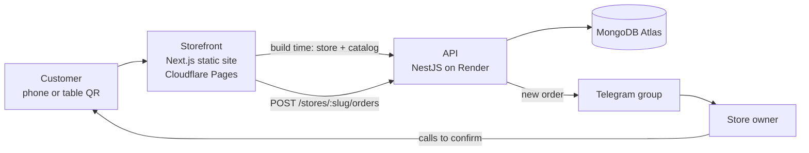

# kld-commerce-kit

A reusable ordering kit for small food businesses and shops: **browse the menu → build a cart → place an order → the order is saved and pushed to Telegram → the owner calls the customer to confirm.**

No online payment, no customer accounts, no friction. It is built for the way small Vietnamese eateries actually work, and it is already live for its first store, **Quán Ăn Chú Bảy**, a grill-and-beer restaurant with 17 categories and 83 items.

- **Storefront (live demo):** https://chu-bay.pages.dev
- **API health check:** https://kld-commerce-kit.onrender.com/health

> The API runs on a free Render instance that sleeps after 15 minutes of inactivity. The first request after a quiet period can take 30–60 seconds. The storefront wakes it up in the background and the checkout is built to tolerate the delay.

The storefront UI is in Vietnamese (it is store content and branding); the code, comments and docs are in English.

## Features

**For customers**

- Menu with sticky category tabs, a "featured" tab, accent-insensitive search (`lau` finds `Lẩu`) and product detail popups
- Cart that survives reloads; side panel on desktop, bottom bar and sheet on mobile
- Three ways to order: **dine in now**, **reserve a table** (date, time slot, party size) or **home delivery** (address, optional time)
- **Table QR codes**: scanning a code opens the menu with `?t=<table>`, which switches checkout to a note-only form (no phone number needed, the order is tagged with the table)
- Price ranges ("150–200K") and market-price items are handled honestly: the total is shown as a minimum and the store confirms the final price by phone

**For store owners**

- Every order lands in a Telegram group within seconds, with the items, total, delivery details, a **Zalo** link and a tappable phone number for the customer
- Orders are also stored in MongoDB, so nothing is lost if Telegram is down

**Engineering**

- Prices are computed on the server; the client only sends product ids and quantities
- Idempotent order creation: a retried request returns the original order instead of creating a duplicate
- One Zod contract (`packages/shared`) validates requests on the API and API responses in the storefront
- Multi-store by design: one API serves many stores, each with its own seed data and branding

## Architecture



## Tech stack

| Area          | Choice                                                                |
| ------------- | --------------------------------------------------------------------- |
| Monorepo      | pnpm workspaces + Turborepo                                           |
| API           | NestJS 12, TypeScript, ESM                                            |
| Database      | MongoDB Atlas + Mongoose                                              |
| Validation    | Zod 4 (shared package) + `nestjs-zod`                                 |
| API docs      | `@nestjs/swagger`                                                     |
| Logging       | pino (`nestjs-pino`), request ids, no bodies or phone numbers logged  |
| Storefront    | Next.js 16 (App Router, static export), React 19, Tailwind CSS 4, Zustand |
| Notifications | Telegram Bot API                                                      |
| Hosting       | Render (API) · Cloudflare Pages (storefront) · Atlas M0 (database)    |

## Repository structure

```
kld-commerce-kit/
├─ apps/
│  ├─ api/            NestJS API, shared by all stores
│  └─ web/            Storefront (Next.js)
│     └─ brands/<slug>/   per-store theme and presentation config
├─ packages/
│  └─ shared/         Zod schemas and types used by both apps
└─ seed/
   └─ stores/<slug>.json   store info, categories and menu
```

## Getting started

**Prerequisites:** Node 24 (see `.nvmrc`), pnpm 10 (via Corepack: `corepack enable`) and a MongoDB database (a free [Atlas](https://www.mongodb.com/atlas) cluster works). A Telegram bot is optional in development.

```bash
git clone https://github.com/khangldit/kld-commerce-kit.git
cd kld-commerce-kit
corepack enable
pnpm install
```

**1. Configure the API** by creating `apps/api/.env`:

```bash
NODE_ENV=development
PORT=3000
MONGODB_URI=mongodb+srv://<user>:<password>@<cluster>.mongodb.net/kld-commerce-kit
# Optional in development; without it orders are saved but not pushed to Telegram
TELEGRAM_BOT_TOKEN=
# Comma-separated browser origins allowed to call the API (default: http://localhost:3001)
CORS_ORIGINS=http://localhost:3001
# Serve Swagger UI at /docs
ENABLE_SWAGGER=true
```

**2. Configure the storefront** by creating `apps/web/.env.local` from the example and pointing it at your local API:

```bash
cp apps/web/.env.example apps/web/.env.local
# then set NEXT_PUBLIC_API_URL=http://localhost:3000
```

**3. Load the demo store** (idempotent, safe to run repeatedly):

```bash
pnpm seed chu-bay
```

**4. Run everything:**

```bash
pnpm dev          # API on :3000, storefront on :3001
```

Open http://localhost:3001 for the storefront and http://localhost:3000/docs for the API docs. Append `?t=Ban-02` to the storefront URL to try table mode.

To receive orders in Telegram, create a bot with [@BotFather](https://t.me/BotFather), set `TELEGRAM_BOT_TOKEN`, add the bot to a group and put the group's chat id into `store.notifications.telegramChatId` in the seed file.

### Useful scripts

| Command                     | What it does                                             |
| --------------------------- | -------------------------------------------------------- |
| `pnpm dev:api` / `dev:web`  | Run one app only                                         |
| `pnpm build`                | Build everything (the storefront build needs the API up) |
| `pnpm typecheck` · `pnpm lint` | Type-check and lint all packages                      |
| `pnpm seed <store-slug>`    | Upsert a store, its categories and products from `seed/` |

## API

| Method | Route                   | Purpose                  |
| ------ | ----------------------- | ------------------------ |
| GET    | `/health`               | Health check and warm-up |
| GET    | `/stores/:slug`         | Public store info        |
| GET    | `/stores/:slug/catalog` | Categories and products  |
| POST   | `/stores/:slug/orders`  | Create an order request  |

An order is a discriminated union on `fulfillment` (`dine_in` or `delivery`). The client never sends prices:

```jsonc
POST /stores/chu-bay/orders
{
  "fulfillment": "delivery",
  "phone": "0901234567",
  "address": "12 Nguyen Trai, Ninh Kieu, Can Tho",
  "scheduledAt": "2026-12-01T19:00:00+07:00", // optional; absent = as soon as possible
  "note": "less spicy",
  "items": [{ "productId": "<id>", "qty": 2 }],
  "idempotencyKey": "<client-generated uuid>"
}
```

Errors share one shape, `{ statusCode, code, message, details?, requestId? }`, and clients switch on `code` (for example `VALIDATION_FAILED` or `PRODUCTS_UNAVAILABLE`).

## Adding a store

No code changes are needed for a store that accepts the existing storefront design:

1. Create `seed/stores/<slug>.json` and run `pnpm seed <slug>`
2. Add `apps/web/brands/<slug>/` (`config.ts` and `theme.css`) and register it in `brands/index.ts`
3. Put the store's images in `apps/web/public/brands/<slug>/`
4. Create a hosting project with `STORE_SLUG=<slug>` and add its origin to the API's `CORS_ORIGINS`

## Deployment

- **API:** a Render web service built from the monorepo root (build `@kld/shared`, then `@kld/api`; start `node dist/main.js`; health check `/health`)
- **Storefront:** a static export (`next build` writes `apps/web/out`) served by Cloudflare Pages. The build wakes the API, then bakes the store and menu into the pages, so a menu change needs a rebuild
- **Database:** MongoDB Atlas

## Roadmap

- [x] Catalog and order API, Telegram notifications, structured logging
- [x] Storefront with table QR mode, deployed
- [ ] Hardening pass (security headers, rate limiting), performance pass
- [ ] Automated tests (Vitest + supertest) and CI
- [ ] Admin dashboard: menu editing, order list, order status
- [ ] Second store, then extract the storefront logic into a headless package so stores can have fully custom UIs

## Author

Built by [@khangldit](https://github.com/khangldit).

## License

No license has been chosen yet, so all rights are reserved. Open an issue if you would like to use the code.
